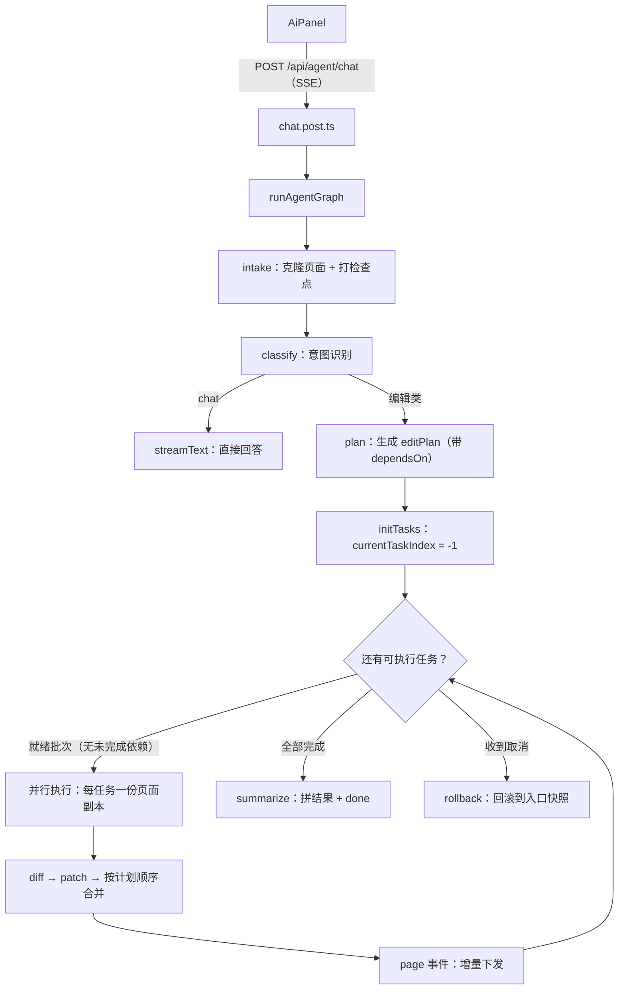

# Agent Server（pi + 自建编排层）

大屏编辑器的 AI 后端。模型调用用 [pi](https://github.com/badlogic/pi-mono)（`pi-ai` + `pi-agent-core`），
编排（意图 → 计划 → 依赖调度 → 执行 → 回滚）是自己写的一层轻量图，位于 `server/agent/graph/`。

> 为什么不直接用 LangGraph：课程那套图编排的核心是"显式状态 + 条件边 + 任务级调度"。
> 本项目只需要这四件事，且要与前端 SSE 协议、页面 DSL 深度耦合，引入整棵 LangChain 依赖
> 收益不抵成本。这里用约 800 行实现了等价能力，模型层仍是 pi。

## 一次请求发生了什么



关键设计：

| 问题                            | 做法                                                                                                    |
| ------------------------------- | ------------------------------------------------------------------------------------------------------- |
| 数据源还没创建，图表怎么知道 id | 规划阶段写占位符 `${t1.dataSourceId}`，执行阶段按已完成任务的产物替换                                   |
| 并行任务互相覆盖                | 每个任务在自己的页面副本上跑，产出 patch，调度器按计划顺序合并                                          |
| 取消后状态怎么办                | 客户端 `POST /api/agent/cancel` 通知服务端，服务端停循环 → 下发 `rollback` → 关流；前端另存本地快照兜底 |
| 取消/失败前已下发的页面         | 前端把整次运行的多次 `page` 合并成一条撤销记录，`rollback` 事件直接恢复快照                             |

## 目录

```text
server/
├── agent/
│   ├── graph/
│   │   ├── run.ts          # 图入口：意图 → 计划 → 调度 → 汇总
│   │   ├── classify.ts     # 意图识别节点
│   │   ├── plan.ts         # editPlan 生成 + 语义纠偏
│   │   ├── scheduler.ts    # 依赖分批、并行执行、patch 合并、进度上报
│   │   ├── patch.ts        # diff / merge / 结构校验
│   │   ├── state.ts        # AgentState（page/plan/tasks/currentTaskIndex）
│   │   ├── checkpoint.ts   # run 级检查点（回滚、排查）
│   │   ├── llm.ts          # 结构化调用（JSON Schema 约束 + 校验 + 重试）、流式文本
│   │   └── executors/
│   │       ├── index.ts    # 按任务类型分发
│   │       ├── base.ts     # 任务级 pi Agent 装配（工具子集、预算、占位符替换）
│   │       └── page.ts     # 整页生成：区块清单 → 实例化 → 建数据源 → 绑定
│   ├── spec/               # TypeBox 版页面/节点/数据源/计划 JSON Schema + 校验
│   ├── rag/                # ECharts 配置知识库：语料、建库产物、检索、Tool
│   ├── skills/             # 按需加载的设计规范（科技风）
│   ├── mock.ts             # 离线 mock provider（NUXT_AI_MOCK=1）
│   ├── tools.ts            # 16 个编辑工具
│   ├── materials.ts        # 请求级物料目录
│   ├── data.ts             # 数据源结构推断 + encode 对齐
│   ├── prompt.ts           # 数据/事件约定、节点 Schema 片段
│   ├── loop.ts             # direct 模式（跳过规划，自主工具循环）
│   └── model.ts            # pi 模型解析（内置 provider / 自定义 OpenAI 兼容 / mock）
├── api/agent/
│   ├── chat.post.ts        # 主入口（SSE）
│   └── cancel.post.ts      # 取消运行
scripts/build-rag.ts        # 建库脚本（pnpm rag:build）
shared/schema/
├── page.ts / material.ts   # 页面与物料 DSL
└── agent.ts                # 请求体与 SSE 事件协议
```

## 任务类型

| type     | 执行节点         | 干什么                            | 依赖场景               |
| -------- | ---------------- | --------------------------------- | ---------------------- |
| `node`   | 工具 Agent       | 增删组件、改 props/样式/位置      | 无                     |
| `chart`  | 工具 Agent + RAG | 加图表、改 ECharts option         | 依赖 data              |
| `data`   | 工具 Agent       | 建/改数据源                       | 无                     |
| `bind`   | 工具 Agent       | 数据源绑到组件（顺带对齐 encode） | 依赖 data + chart      |
| `event`  | 工具 Agent       | 生成事件代码                      | 依赖目标组件           |
| `canvas` | 工具 Agent       | 画布尺寸/背景                     | 无                     |
| `page`   | 结构化调用       | 整页区块规划 → 服务端实例化       | 独占，不与其他任务并发 |

## 工具集

| 工具                                   | 作用                                                      |
| -------------------------------------- | --------------------------------------------------------- |
| `add_node`                             | 从物料目录添加组件（grid / precision 两种布点方式）       |
| `update_node_props`                    | 合并组件 props（图表改 `option`，文本改 `content`）       |
| `set_node_style`                       | 合并组件内联样式                                          |
| `set_node_layout`                      | 改位置尺寸（3 列 5 行网格或像素精确）                     |
| `arrange_grid`                         | 指定组件按 N 列自动排列                                   |
| `remove_node` / `duplicate_node`       | 删除 / 复制组件                                           |
| `set_canvas`                           | 画布尺寸与背景色                                          |
| `add_data_source`                      | 添加静态 / API 数据源，可同时绑定组件                     |
| `update_data_source`                   | 修改数据源配置；数据字段变了会顺带对齐已绑定图表的 encode |
| `bind_data_source`                     | 把数据源绑到组件，并校验/改写图表 encode                  |
| `set_node_event` / `remove_node_event` | 组件事件代码的写入与删除                                  |
| `list_nodes`                           | 列出组件（标记选中项、数据源、事件）                      |
| `search_echarts_docs`                  | 检索 ECharts 配置知识库（RAG）                            |
| `load_skill`                           | 按需加载设计规范正文                                      |

## API

### POST /api/agent/chat

```jsonc
{
  "message": "加一个销售柱状图，用接口数据",
  "page": { /* 完整 PageSchema */ },
  "history": [ { "role": "user" | "assistant", "content": "..." } ],
  "selectedNodeIds": ["node-id"],
  "images": [ { "data": "base64", "mimeType": "image/jpeg" } ],
  "materials": [ /* 前端当前物料目录，服务端以它为准建节点 */ ],
  "mode": "plan" // plan | direct
}
```

事件（`event:` 名与 `data.type` 一致）：

| 事件        | 时机           | data                                                               |
| ----------- | -------------- | ------------------------------------------------------------------ |
| `run_start` | 建立连接后     | `{ runId }`                                                        |
| `stage`     | 阶段切换       | `{ stage: 'classify' \| 'plan' \| 'execute' \| 'summarize' }`      |
| `intent`    | 意图识别完成   | `{ intent, reason, skills? }`                                      |
| `plan`      | 计划生成完成   | `{ summary, tasks: [{ id, name, type, dependsOn, instruction }] }` |
| `task`      | 任务状态变化   | `{ id, status, name?, error?, actions? }`                          |
| `progress`  | 进度变化       | `{ done, total }`                                                  |
| `text`      | 模型逐字输出   | `{ delta }`                                                        |
| `tool`      | 工具开始/结束  | `{ phase, name, label, ok?, taskId? }`                             |
| `action`    | 一项修改完成   | `{ action, taskId? }`                                              |
| `page`      | 每个任务合并后 | `{ page }` 完整 DSL（增量应用）                                    |
| `rollback`  | 取消/中止      | `{ page, reason }` 入口快照                                        |
| `done`      | 结束           | `{ reply, actions, aborted, intent? }`                             |
| `error`     | 运行失败       | `{ message }`                                                      |

### POST /api/agent/cancel

```jsonc
{ "runId": "..." } // → { ok: boolean, active: number }
```

不断开 SSE，而是中止服务端循环，让 `rollback` / `done` 还能推回前端。
前端另有兜底：1.5s 内没收到 `done` 就强制 abort fetch，并用本地快照恢复页面。

## 结构化输出怎么保证

`pi-ai` 的 `toolChoice` 只有 `auto | none`，没有"必须调用某工具"的强制模式，所以：

1. 提示词里直接给出目标 JSON Schema（TypeBox 产物就是标准 JSON Schema，无需转换）；
2. 解析时容错：先去 markdown 围栏，再取第一个平衡的 `{...}`，最后走 `parseJsonWithRepair`；
3. 用同一份 Schema 做运行时校验，不通过就把错误信息回灌给模型重试一次；
4. 规划结果再做语义纠偏：去重 id、丢弃指向后续任务的依赖、整页任务独占。

## ECharts RAG

```bash
pnpm rag:build              # 读 corpus → 切块 → TF/DF → 写 index.generated.ts
NUXT_AI_EMBED_MODEL=text-embedding-3-small pnpm rag:build   # 顺便算向量
```

- 语料在 `server/agent/rag/corpus/*.md`（官方 option 文档整理：grid / axis / series / dataset / legend / visualMap …）；
- 检索默认 BM25（中文按单字 + 二元组分词），配了 embedding 模型则走向量余弦，调用失败自动退回 BM25；
- 图表任务执行前自动预检索一次（省一轮工具往返），模型仍可再调 `search_echarts_docs` 细化。

## Skill

`server/agent/skills/bodies.ts` 里放规范正文，`index.ts` 里注册 id/描述/触发词。
只把「id + 一句话描述」常驻提示词，需要时由 `load_skill` 加载正文；用户提到"科技风"等触发词时自动预加载。

## 配置

| 环境变量                | 默认值                 | 说明                                                            |
| ----------------------- | ---------------------- | --------------------------------------------------------------- |
| `NUXT_AI_PROVIDER`      | `moonshotai`           | pi-ai 供应商 id；目录外的自定义 provider 按 OpenAI 兼容协议注册 |
| `NUXT_AI_MODEL`         | `kimi-k2-0905-preview` | 模型 id                                                         |
| `NUXT_AI_BASE_URL`      | （跟随 provider）      | 自定义 OpenAI 兼容端点，如 `https://host/v1`                    |
| `NUXT_AI_API_KEY`       | 无（必填）             | API Key，未设置时接口返回 503                                   |
| `NUXT_AI_EMBED_MODEL`   | 无                     | 配了才启用向量检索                                              |
| `NUXT_AI_MOCK`          | 无                     | `1` 时用离线 mock provider，不需要 key                          |
| `NUXT_AI_MOCK_DELAY_MS` | `0`                    | mock 模式下每次结构化调用的模拟延迟，用于测试取消/回滚          |

## 运行验证

```bash
pnpm dev
curl -N -X POST http://localhost:3000/api/agent/chat \
  -H 'content-type: application/json' \
  -d '{"message":"生成一个科技风的销售大屏","page":{"canvas":{"width":1920,"height":1080,"backgroundColor":"#f4f4f5"},"nodes":[],"dataSources":[]}}'
```

正常顺序：`run_start` → `stage(classify)` → `intent` → `stage(plan)` → `plan` → `progress` →
若干 `task/progress/page` → `stage(summarize)` → `text` → `done`。

模型不可用时会在 `run_start` 后收到 `error`。想在没有模型配额的情况下回归整条链路：

```bash
NUXT_AI_MOCK=1 pnpm dev
```

mock 模式走的是**真实的** pi Agent 循环、真实的工具执行和 patch 合并，只是模型输出被脚本化，
因此可以用来验证调度、进度、回滚。生产环境不要打开。

## 已知取舍

- 检查点存在进程内存（最多 50 条），重启即失效；要跨进程恢复需换成 SQLite/Postgres。
- `page` 任务是替换语义（清空现有组件后重建），只由"整页生成"意图触发。
- 并行批次内每个任务各跑一个 Agent，token 消耗高于一次性生成，靠"任务数 ≤ 6"约束成本。
